# healthvibe iPhone Shortcut — design

Status: **draft for review**. No code yet; coding is paused until this design is settled.

healthvibe is a self-hosted, multi-user Apple Health dashboard (FastAPI, SQLite, HTMX). Apple Health data only leaves the phone through (a) a one-off `export.xml` from the Health app, or (b) something running on the phone. For daily updates we ship one **master Shortcut** that reads only the metrics each user has enabled and POSTs them to that user's healthvibe server.

## 1. Decisions so far

| Topic | Decision |
|---|---|
| Distribution | A signed `.shortcut` file made on a friend's Mac once per release (`shortcuts sign --mode anyone`) and attached to the GitHub release. Signing without a Mac is under research (§9). |
| Shape | One master Shortcut with a `Find Health Samples` block for every supported metric ([metrics.md](metrics.md)), each gated on whether that metric is enabled. |
| Metric choice | Lives in both places; **the web app wins**. The Shortcut GETs the enabled list on every run. A first-run Choose Menu lets the user pick on the phone, and that choice is synced up to the server. The server rejects metrics that aren't enabled. |
| Onboarding | The web app shows a QR code holding the server URL and a one-time setup code; the Shortcut exchanges it for a per-user upload token stored on the phone. |
| Trigger | User picks one on first run (§6a); default "Alarm is stopped", **Run Immediately**. Health data can only be read while the phone is unlocked. |
| export.xml | Default: store everything, show only enabled metrics. Option at import time: import only selected metrics (§7). |
| Sleep score | Apple's score isn't readable; healthvibe computes its own (§8). |

## 2. Flow

```mermaid
sequenceDiagram
    autonumber
    actor U as User
    participant W as healthvibe web app
    participant S as Shortcut (iPhone)
    participant H as Apple Health

    rect rgb(40,40,60)
    note over U,S: One-time setup
    U->>W: Log in, open Setup page
    W-->>U: Link to signed .shortcut (this release) + QR (url + setup code, 10 min, one use)
    U->>S: Import signed Shortcut, run it once
    S->>U: Scan QR (camera)
    S->>W: POST /api/v1/shortcut/claim {setup_code, device_name, shortcut_version}
    W-->>S: {upload_token, user, server_config}
    S->>S: Save hv-config.json in iCloud Drive/Shortcuts
    S->>U: Choose Menu: metrics to enable (pre-ticked from server defaults)
    S->>W: PUT /api/v1/shortcut/metrics {enabled[]} (accepted only if web app has no explicit choice yet)
    U->>U: Create "Alarm is stopped" automation, Run Immediately
    end

    rect rgb(30,50,40)
    note over U,H: Every morning
    U->>S: Stops alarm (phone unlocked) → automation runs
    S->>W: GET /api/v1/shortcut/config (Bearer token)
    W-->>S: {enabled[], since per metric, min_shortcut_version, batch limits}
    loop each metric block in master Shortcut
        alt metric enabled
            S->>H: Find Health Samples (type fixed, start > since)
            H-->>S: samples
        else disabled
            S->>S: skip (never read)
        end
    end
    S->>W: POST /api/v1/ingest (batched JSON)
    W->>W: validate, reject non-enabled, dedupe, store
    W-->>S: {accepted, duplicates, rejected, next_since}
    S->>U: Notification per user setting (Always / Only on errors)
    end
```



## 3. Configuration

### 3.1 On the phone
`iCloud Drive/Shortcuts/healthvibe/hv-config.json` (via Shortcuts' "Save File"/"Get File"):

```json
{ "server": "https://health.example.com", "token": "hvu_…", "device": "Toby's iPhone", "configured_at": "2026-11-03T07:00:00-05:00" }
```

Nothing else is stored on the phone; the metric list and cursors come from the server every run, so changes in the web app take effect on the next run without reinstalling.

### 3.2 `GET /api/v1/shortcut/config`
Auth: `Authorization: Bearer <upload token>`.

```json
{
  "schema": 1,
  "user": "toby",
  "min_shortcut_version": "0.1.0",
  "latest_shortcut_version": "0.1.0",
  "latest_shortcut_url": "https://github.com/mortbrew/healthvibe/releases/download/v0.1.0/healthvibe.shortcut",
  "enabled": ["stepCount", "heartRate", "sleepAnalysis", "bodyMass"],
  "since": {
    "stepCount": "2026-11-02T06:58:11-05:00",
    "heartRate": "2026-11-02T06:59:40-05:00",
    "sleepAnalysis": "2026-11-02T06:45:00-05:00",
    "bodyMass": "2026-10-30T07:10:00-05:00"
  },
  "default_lookback_days": 7,
  "max_lookback_days": 30,
  "max_samples_per_metric": 5000,
  "max_request_bytes": 5242880,
  "notify": "errors_only"
}
```

`notify` is a per-user setting in the web app: `always` (notification after every run with counts) or `errors_only` (default; notify only on failures, 426 or rejected metrics). The Shortcut reads it each run.

Metric keys are the HealthKit identifier without the `HKQuantityTypeIdentifier` / `HKCategoryTypeIdentifier` prefix (see [metrics.md](metrics.md)). A metric with no prior upload gets `since = now - default_lookback_days`.

### 3.3 `PUT /api/v1/shortcut/metrics` (first-run sync)
Body `{"enabled": ["stepCount", …], "source": "shortcut-first-run"}`. Web app wins: if the user has already saved choices on the Data Sources page, the server returns `409` with the server list and the Shortcut uses that. Otherwise the phone's list is saved and marked as user-chosen.

### 3.4 `POST /api/v1/shortcut/claim`
Body `{"setup_code": "…", "device_name": "…", "shortcut_version": "0.1.0"}` → `{"upload_token": "hvu_…", "config": {…same as 3.2…}}`. **One device per user:** each user has a single upload token; claiming a new setup code revokes the previous token (moving to a new phone = scan a new QR). Setup code: 128-bit random, 10-minute TTL, single use, hashed at rest, rate-limited per IP.

## 4. Upload JSON schema — `POST /api/v1/ingest`

```json
{
  "schema": 1,
  "shortcut_version": "0.1.0",
  "device": "Toby's iPhone",
  "run_id": "6f1c…(UUID made by the Shortcut)",
  "batch": { "index": 0, "count": 3 },
  "tz": "America/New_York",
  "metrics": {
    "stepCount": {
      "unit": "count",
      "samples": [
        { "start": "2026-11-02T07:00:00-05:00", "end": "2026-11-02T07:10:00-05:00", "value": 812, "source": "Toby's Apple Watch" }
      ]
    },
    "sleepAnalysis": {
      "unit": null,
      "samples": [
        { "start": "2026-11-03T01:12:00-05:00", "end": "2026-11-03T02:01:00-05:00", "value": "asleepCore", "source": "Toby's Apple Watch" }
      ]
    }
  }
}
```

Workouts are sent in a separate top-level `workouts` array (from the Shortcut's "Find Workouts" action), not inside `metrics`:

```json
"workouts": [
  { "type": "running", "start": "2026-11-02T17:30:00-05:00", "end": "2026-11-02T18:05:12-05:00",
    "duration_s": 2112, "active_energy_kcal": 412, "distance_km": 6.1, "avg_hr": 151, "max_hr": 174,
    "source": "Toby's Apple Watch" }
]
```
Fields other than `type`, `start`, `end` are optional. Dedupe hash = `user_id | workout | type | start | end | source`. Workouts are gated by the `workouts` key in `enabled`.

Rules:
- `value` is a number for quantity types (in the unit listed in metrics.md; the Shortcut converts with "Get Details of Health Sample → Value" in a fixed unit) and a string enum for category types.
- `start`/`end` are ISO-8601 with offset. Server stores UTC + original offset.
- The raw request JSON is **deleted as soon as it has been parsed** and committed; only the parsed rows are kept (failed parses are kept for 24 h for debugging, then deleted).
- Unknown metric → `422`. Metric not enabled for this user → dropped and listed in `rejected` (not a whole-request failure, so a stale phone doesn't lose everything).
- Response:
```json
{ "accepted": 1203, "duplicates": 31, "rejected": {"vo2Max": "not_enabled"}, "next_since": {"stepCount": "2026-11-03T06:58:00-05:00"} }
```

## 5. Picking up where the last run stopped, and dedupe

- **Server-side cursors.** For each (user, metric) the server keeps `last_sample_end` from the last *successful* ingest. `config.since` hands it to the Shortcut, which filters `Start Date is after <since>`. The phone keeps no state, so a failed run simply re-sends the same window next time.
- **Overlap is deliberate.** `since` is moved back by 10 minutes (Watch data syncs to the phone late), so some readings arrive twice.
- **Content hash.** Every reading gets `hash = sha256(user_id | metric | start | end | value | unit | source)`. `readings` has `UNIQUE(user_id, hash)` and inserts use `INSERT … ON CONFLICT DO NOTHING`. The same path is used by the export.xml importer, so a daily upload that overlaps an import never doubles up.
- **Cursor advance** happens only after a batch commits. With multiple batches, each batch advances only the metrics it fully contains.
- **Gaps.** If the user skipped days (phone off, alarm not used), `since` is older than `max_lookback_days`; the Shortcut caps at that and the web app shows "gap: import export.xml or run the Shortcut manually with backfill".
- **Edits/deletions in Health** are not detected (Shortcuts has no anchored query). Known limitation; a fresh export.xml import fixes it.

## 6a. Choosing a trigger on first run

Shortcuts can't create automations itself, so after QR setup and metric choice the Shortcut asks how it should run, saves the answer, and walks the user through creating the automation.

1. **Choose Menu** "How should healthvibe run each day?" (choices below).
2. Saves `trigger` in `hv-config.json` and sends it with `PUT /api/v1/shortcut/trigger {"trigger": "alarm_stopped", "detail": "Wake-up alarm"}`. The server keeps it in the user's config (web app shows it and uses it for the stale-upload warning). Unlike metrics, the phone's choice is kept here because only the phone knows which automation exists.
3. Shows a **Quick Look/Show Result** text with step-by-step instructions for that trigger (below).
4. **Opens the Automation tab** with `Open URLs` → `shortcuts://automations` (or `shortcuts://create-automation` to jump straight to the new-automation sheet). Neither is in Apple's documented URL-scheme list ([Apple: Shortcuts URL schemes](https://support.apple.com/guide/shortcuts/apda283236d7/ios)), but both are reported working by users and developers ([Stack Overflow](https://stackoverflow.com/questions/69969746/how-to-deep-link-to-automation-in-shortcut-app), [r/shortcuts](https://www.reddit.com/r/shortcuts/comments/1fdkqaj/shortcuts_automation_url_scheme/)). Test on iOS 26/27; if it fails, fall back to plain `shortcuts://` and the instructions say "tap Automation".

| Menu option | Trigger in Shortcuts | Run without asking? | Notes |
|---|---|---|---|
| When I stop my alarm (recommended) | Alarm → Is Stopped → Wake-up / Any | **Yes** (Alarm is on Apple's list) | Phone is usually being unlocked, so Health reads work. |
| At a set time | Time of Day → time, Daily | **Yes** | Fails silently if the phone is locked at that time; next run catches up. |
| When I arrive home | Arrive → Home location | **Yes** (Arrive on list) | Location permission needed; phone may be locked → catch-up. |
| When I plug in the charger | Charger → Is Connected | **Yes** (Charger on list) | Often fires while locked at night → mostly catch-up runs; pair with another trigger. |
| When Sleep Focus turns off | Focus → Sleep → When Turning Off | **Unverified.** Apple's list names "Do Not Disturb", not every Focus. Alternative with confirmed support: **Sleep → Waking Up** (needs a Health sleep schedule). | Recommend offering "Waking up (sleep schedule)" in place of / alongside this. |
| Manual only | none | n/a | User runs it from the widget, Siri ("healthvibe"), or the Action button. |

Sources for supported triggers and the run-without-asking list: [Apple: Add automations](https://support.apple.com/guide/shortcuts/add-automations-apdfbdbd7123/ios) (lists Time of Day, Alarm, Sleep, Arrive, Leave, CarPlay, …, Do Not Disturb, Low Power Mode, Battery Level, Charger as runnable automatically), [Apple: Setting triggers](https://support.apple.com/guide/shortcuts/setting-triggers-apde31e9638b/ios) (Focus When Turning On/Off, Charger Is Connected/Disconnected), [What's new in Shortcuts 26](https://support.apple.com/en-us/125148) (Alarm "When my alarm is stopped").

Instruction text template (alarm example):
1. Tap **+** (New Automation) in the Automation tab.
2. Choose **Alarm** → **Is Stopped** → **Wake-Up** (or Any).
3. Choose **Run Immediately** (on iOS 27: turn **Confirm Before Run** off) and turn off **Notify When Run** if you like.
4. Tap **Next** → pick the **healthvibe** shortcut → **Done**.
5. Tomorrow, check the web app's Status card for "last upload".

The Choose Menu, Ask for Input and Show Result steps only run on first run / when `hv-config.json` lacks a trigger; automated runs never hit an interactive step (those would block Run Immediately). Re-run setup any time with the Shortcut's "Settings" option (shown when run manually).

**Catch-up and stale warnings.** Every run uploads everything since the last successful upload (§5), so missed days catch up automatically (capped at `max_lookback_days`). The server records `last_upload_at` per device; the web app shows a banner and dashboard Status card when no upload arrived for longer than expected for the chosen trigger (default: 36 h for daily triggers, off for Manual), e.g. "No upload from Toby's iPhone since Sun 7:02 AM — check the automation".

Stale-upload alerts (36 h default) always show in the web app, plus optional per-user alert channels set on the user's Notifications page:
- **Email (SMTP):** server admin configures `SMTP_HOST/PORT/USER/PASSWORD/FROM` in `.env`; each user sets their address and turns email on/off.
- **Push via ntfy:** user enters an ntfy topic URL (ntfy.sh or self-hosted) and optional access token.
- **Push via Apprise:** user enters one or more Apprise URLs (covers Pushover, Gotify, Telegram, Discord, Matrix, etc.); healthvibe ships the `apprise` library.
- One alert per stale period (re-armed after the next successful upload); a "Send test" button per channel. Run errors reported by the server (e.g. repeated 426/401) use the same channels.

## 6. Versioning and Shortcut updates

- The Shortcut has a `HV_VERSION` text action at the top (semver, matches the GitHub release tag) and sends it in every request.
- Server returns `min_shortcut_version` / `latest_shortcut_version` / `latest_shortcut_url` in config.
  - Below min: server answers `426 Upgrade Required`; Shortcut shows an alert with the download link and stops.
  - Below latest: upload continues; a one-line notification suggests updating.
- Updating = import the new signed file and replace the old one. Config lives in `hv-config.json`, so it survives; the alarm automation must be re-pointed at the new Shortcut if the name changed (keep the name `healthvibe` stable to avoid this).
- Adding a metric = new block in the master Shortcut → new release + re-sign. The server can list metrics the user's Shortcut version doesn't support yet ("update Shortcut to sync X").
- `schema` in requests is versioned separately; server supports current and previous schema.

## 7. export.xml import options

Reconciling "store everything, show enabled" with "choose at import time":
- **Default: Store everything.** Every record is stored (same hash/dedupe). Dashboard and MCP only show enabled metrics; enabling a metric later instantly shows its history.
- **Option: Only selected metrics.** Import page lists metrics found in the file (first pass counts types while streaming) with checkboxes pre-set to the user's enabled list. Unticked types are skipped during parsing and never stored.
- Either way, nothing from the file is kept after import except the parsed rows (the raw upload is deleted after a successful parse unless the user asks to keep it).
- Streaming `iterparse` + batched inserts; files over 1 GB are fine.

## 8. Sleep score

Apple's Sleep Score (iOS 26 / watchOS 26) is **not exposed** to HealthKit or Shortcuts. Apple DTS confirmed "As of today, there is no API that allows the access to sleep scores" ([Apple Developer Forums 800403](https://developer.apple.com/forums/thread/800403)); vendors such as Terra report it as always null ([Terra docs](https://docs.tryterra.co/help-center/help-topics/data-api-sdk/provider-coverage-and-per-provider-data-availability/apple-sleep-score-not-exposed-by-healthkit)).

healthvibe computes its own score from `sleepAnalysis` stage samples, using Apple's published weighting (duration 50, bedtime 30, interruptions 20; [iDrop News](https://www.idropnews.com/news/apple-seeds-first-ios-262-beta-to-developers-heres-whats-new/255110/)):

| Part | Points | Calculation (v1, tunable) |
|---|---|---|
| Duration | 50 | asleep (core+deep+REM+unspecified) vs. user goal (default 8 h): full points at ≥ goal, linear down to 0 at 4 h |
| Bedtime | 30 | sleep onset vs. user's 14-day median onset: full within ±30 min, linear to 0 at ±2.5 h |
| Interruptions | 20 | awake segments ≥ 2 min after onset: 0 → 20, each one −4, also −1 per 5 min awake |

The v1 formula is **fixed** (not user-tunable; only the sleep goal is a user setting). The dashboard labels it "healthvibe sleep score", shows the breakdown, and documents that it will not exactly match the Watch.

## 9. Signing a Shortcut without a Mac — findings

iOS only imports `.shortcut` files that are signed (AEA archive with an Apple-issued CMS signature chain). Apple's official tool is `shortcuts sign` on macOS.

| Option | How | Feasibility |
|---|---|---|
| Friend's Mac (chosen) | `shortcuts sign --mode anyone -i healthvibe.shortcut -o healthvibe-signed.shortcut` while signed into an Apple ID | **Works.** Once per release. |
| GitHub Actions `macos-*` runner | Run `shortcuts sign` in CI | **Not practical.** The command needs an Apple ID signed into iCloud on that machine; runners are fresh VMs and an interactive iCloud login with 2FA can't be scripted. Storing Apple ID credentials in CI is also a security/ToS risk. A self-hosted Mac runner would work but needs a Mac. |
| iCloud link | Share → Copy iCloud Link from the iPhone | **Works, no Mac,** but deferred: not approved for now. |
| [0xilis/shortcut-sign](https://github.com/0xilis/shortcut-sign) (+ [libshortcutsign](https://github.com/0xilis/libshortcutsign)) | Open-source Linux/macOS CLI reimplementing Apple's signing | **Technically possible, not recommended.** Needs the signer's Apple ID private key and auth data, which must be dumped from a jailbroken iPhone or an AMFI-disabled Mac ([appleid-key-dumper](https://github.com/0xilis/appleid-key-dumper)). Still beta (v1.0.0-beta.5). Once keys exist, re-signing could run in CI. |
| HubSign (RoutineHub) via [wynx1123/shortcut-signer](https://github.com/wynx1123/shortcut-signer) | POST the unsigned plist to a third-party service | **Works on Linux, risky.** Depends on an unofficial community service; the Shortcut (with server URL patterns) goes to a third party; availability and terms can change. OK for experimenting, not for releases. |
| [scaxyz/shortcut-signing-server](https://github.com/scaxyz/shortcut-signing-server) | Self-hosted HTTP wrapper | Still runs `shortcuts sign` underneath, so it needs a Mac. |

Decision: the friend-signed `.shortcut` file on GitHub releases is the **only** distribution channel. Publishing an iCloud link is a **deferred option** (not approved; it would point at Toby's iCloud account). Revisit shortcut-sign or the iCloud link only if the friend's Mac becomes unavailable.

## 10. Security

- Upload tokens: random 256-bit, prefix `hvu_`, stored hashed (argon2/sha256), scoped `upload` only (can't read data back, can't use the MCP), one per user (single device), revocable/replaceable in the web app, never shown.
- QR holds only URL + one-time setup code (10 min, single use). Screenshots of an old QR are useless.
- HTTPS only (via Pangolin). Server refuses plain HTTP in production config.
- Server enforces enabled metrics and per-user isolation; ingest can only write to the token's user.
- Rate limits on claim, config and ingest; request size cap (`max_request_bytes`).
- The signed Shortcut contains **no** secrets or server URLs; it's identical for every user. `hv-config.json` in iCloud Drive holds the token — documented, and users can revoke if the phone or iCloud account is lost.
- Shortcut is readable by anyone (open the actions) so users can verify exactly what it reads and sends.

## 11. Shortcut limits to design around

- **`Find Health Samples` can't take a variable type.** The type is chosen when building the Shortcut, so the master needs one block per metric (~40) each wrapped in `If <enabled list> contains <key>`. Large but straightforward; build it with a consistent block template.
- **Phone must be unlocked.** HealthKit data is encrypted while locked. "Alarm is stopped" usually fires while the user is unlocking; if the read fails, the Shortcut exits quietly and the next run catches up (server cursors).
- **Runtime.** Shortcuts run in the foreground-ish with no hard documented limit, but automations that take tens of seconds or loop over thousands of items get slow/killed. Mitigations: per-metric `Limit` (`max_samples_per_metric`), small `since` windows, and building JSON per metric with "Get Dictionary"/"Combine Text" rather than looping per sample where possible.
- **Payload size.** Heart rate can be thousands of samples per day. Send one request per metric group (batches), keep each under `max_request_bytes` (5 MB default).
- **Units.** Must request a fixed unit per metric in the Shortcut so values are consistent.
- **"Run Immediately"** must be set by the user; Apple doesn't allow imported Shortcuts to create automations.
- **Health permissions** are prompted per type on first run; with ~40 types the first run shows a long permission sheet. Users can deny types they don't want.
- **No anchored queries** → deletions/edits in Health aren't synced (§5).

## 12. Resolved decisions (Nov 3, 2026)

- **Devices:** one device per user, single upload token (§3.4).
- **Raw upload JSON:** deleted once parsed (§4).
- **Run notifications:** per-user setting, Always or Only on errors; default Only on errors (§3.2).
- **Distribution:** signed file on GitHub releases only; iCloud link deferred (§9).
- **Sleep score:** fixed v1 formula (§8).
- **No-upload warning:** 36 h, in web app plus per-user email (SMTP) / push (ntfy, Apprise) (§6a).
- **Workouts:** in v1 (§4, metrics.md).
- **Lookback:** 7 days on first run, 30-day max (§3.2).
- **First-run metric menu:** short — "Recommended / Everything / Choose on web".

## 13. Open questions

1. **Sleep Focus trigger:** Toby will test on a real iPhone whether "Focus → Sleep → When Turning Off" can run without asking. If not, replace it with "Sleep → Waking Up".
